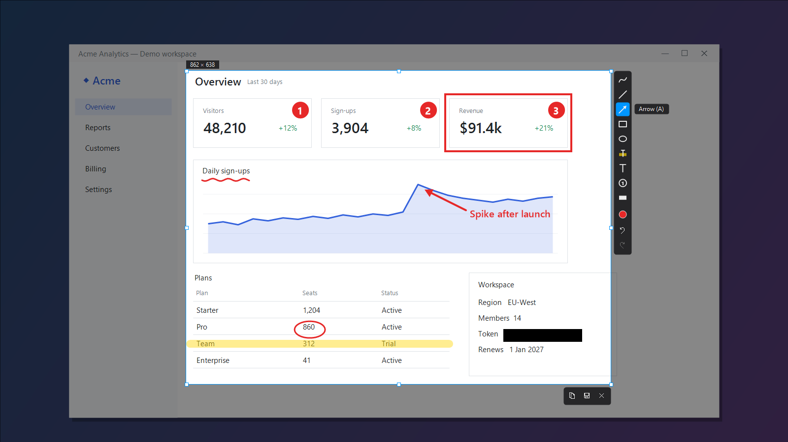
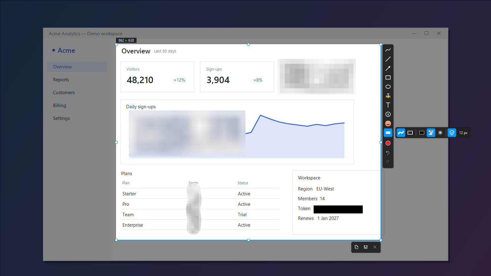

<p align="center">
  
</p>

<h1 align="center">Snip</h1>

<p align="center">
  <b>Screenshot and annotate on Windows and macOS. Offline, instant, tiny.</b><br>
  no network access &middot; 0% CPU when idle &middot; Windows 10/11 &middot; macOS 14+ (experimental)
</p>

A trustworthy replacement for Lightshot. It lives in the tray (Windows) or the menu bar (macOS), never touches the
network, and each version is a few thousand lines of native code you can read: C# on Windows, Swift on macOS.



*Screenshots show Windows; the macOS version has the same layout and tools.*

## Using it

Press the capture hotkey. The screen freezes and dims instantly, so open menus, tooltips and hover states stay in the
picture.

| | Windows | macOS |
|---|---|---|
| Capture | **Win+Shift+S** or **PrtSc**, or left-click the tray icon | **⇧⌘2** by default (any combination you like, see below), or **Capture** in the menu-bar menu |
| Copy and close | **Ctrl+C** or **Enter** | **⌘C** or **Return** |
| Save as (opens in the last folder used) | **Ctrl+S** (PNG/JPG/BMP) | **⌘S** (PNG/JPEG) |
| Undo / redo | **Ctrl+Z** / **Ctrl+Y** | **⌘Z** / **⇧⌘Z** (or your own App Shortcuts) |
| Select the whole display | **Ctrl+A** | **⌘A** |
| Redact cell size | **Ctrl+scroll** | **Option+scroll** |
| Put the tool away, then close (asks for a second Esc once you've drawn something) | **Esc** or right-click | **Esc** or right-click |

- **Drag** to select a region, or **click** a window to select exactly that window. Drag the handles to resize, drag
  inside to move, arrow keys nudge (Shift+arrows resize).
- Pick a tool from the toolbar and draw inside the selection. Hold **Shift** for 45° lines/arrows and square
  boxes/circles.
- **Scroll** changes the size, also while you're still holding the mouse button. A hover preview shows the brush,
  stroke or stamp at its real size before you click. The color button opens the palette. Color, size and tool options
  are remembered.

| Tool | Key | | Tool | Key |
|---|---|---|---|---|
| Pen | P | | Highlighter | H |
| Line | L | | Text | T |
| Arrow | A | | Numbered step (1, 2, 3…) | N |
| Rectangle | R | | Emoji stamp | M |
| Ellipse | E | | Redact | B |

**Text:** click to place, type, **Enter/Return** to finish, **Shift+Enter/Return** for a new line, **Ctrl+V/⌘V**
pastes text. While you're still typing, drag the text by its dashed box to move it (right-click while dragging puts
it back).

**Numbered steps and emoji** are placed when you release the mouse button: scroll to resize while holding. Emoji come
in full colour from the system's emoji font; pick one from the grid next to the tool, and drag while holding the
button to rotate it (Shift snaps to 15°).

### Redact



The redact bar appears next to the tool: **Brush · Box | Black · Pixelate · Blur | secure toggle | cell size**.

- **Brush** (default) paints redaction along the stroke; scroll sets the width. **Box** covers a rectangle. **F**
  switches.
- **Black** is a solid fill. **Pixelate** and **Blur** look like the familiar effects. **Ctrl+scroll** (Windows) or
  **Option+scroll** (macOS) sets the cell size (4-48 px), live, even mid-stroke.
- **Secure** (shield, the default): Pixelate and Blur are generated from fresh randomness plus only a 4-tone palette of
  the covered area and the colours just outside its edge. They never use where anything was, so nothing underneath can
  be recovered, not even by averaging many screenshots of the same content.
- **Insecure** (orange shield): a real pixelation or blur of the covered pixels. It looks the most faithful, but like
  any real blur or pixelation it can be partly reversed. Black is always secure.

Every redaction is flattened into the copied or saved image; there is no hidden layer to remove.

### Record a video (Windows for now)

Select an area, then press the red **Record** button in the action bar. A thin red border marks what's being
recorded, and a small bar next to it shows the time with **Stop** and **Discard**; press the capture hotkey again to
stop too. The pointer is included, sound isn't, and there's no time limit.

When you stop, a window shows the last frame, the length and the file size: **Copy** puts the MP4 on the clipboard as
a file (paste it into a chat or an email), **Save as...** writes it where you like, **Play** opens it in your video
player, **Discard** deletes it. Recordings are H.264 MP4s encoded on the graphics card where possible, so the CPU
stays nearly idle, and they're small: about 0.5-1.5 MB for 10 seconds of a 2560x1440 screen. Record works before you
draw anything; annotations aren't part of videos yet.

### Tray and menu-bar menus

- **Windows tray:** Capture, Use PrintScreen key (on/off), Start with Windows (on/off), Open settings folder, Exit.
- **macOS menu bar:** Capture, current hotkey and **Change hotkey…**, Start at login, Debug logging, Open log,
  Write diagnostics to log, Quit.

### Choosing the hotkey

- **Windows:** Win+Shift+S (taken over from the Snipping Tool) and PrtSc (can be turned off in the tray menu).
- **macOS:** **Change hotkey…** records any combination with ⌘, ⌥ or ⌃ (press it, then Save). From a terminal:
  `~/Applications/Snip.app/Contents/MacOS/Snip --set-hotkey cmd+shift+s`. Combinations another app or macOS already
  owns are refused and the previous hotkey stays; to use ⇧⌘3/4/5, turn the system screenshot shortcut off first
  (System Settings > Keyboard > Keyboard Shortcuts > Screenshots). Undo, Redo, Copy, Paste, Select All and Save… are
  regular menu items, so App Shortcuts you customise in System Settings apply in the overlay.

## Install

Both versions install from source, per user, without admin rights.

### Windows 10 or 11 (x64)

Needs the [.NET 10 SDK](https://dotnet.microsoft.com/download/dotnet/10.0), which includes the Desktop Runtime Snip
runs on.

```powershell
powershell -ExecutionPolicy Bypass -File tools\install.ps1
```

This builds `Snip.exe` (~0.5 MB), copies it to `%LOCALAPPDATA%\Programs\Snip`, adds **Snip** to the Start menu and to
**Settings > Apps > Installed apps**, and starts it. The installed copy registers itself to start with Windows
(`HKCU\...\Run`); copies run from anywhere else never touch autostart.

- **Starting Snip again:** if you exit Snip or turn off *Start with Windows*, start it from the Start menu (search
  "Snip") and turn autostart back on from the tray menu. Launching it while it runs takes a screenshot.
- **Uninstall:** Settings > Apps > Installed apps > Snip > Uninstall, or `tools\uninstall.ps1`.

### macOS 14 or newer (Apple silicon or Intel), experimental

Needs the Xcode command-line tools (`xcode-select --install`).

```bash
cd mac
./install.sh
```

This builds a release binary, assembles `~/Applications/Snip.app`, signs it locally and launches it; a scissors icon
appears in the menu bar. The first capture asks for **Screen Recording** permission (System Settings > Privacy &
Security > Screen Recording); after granting it, quit Snip from its menu and open it again. Optional: run
`./scripts/create-signing-identity.sh` once beforehand so the permission survives rebuilds. More in
[mac/README.md](mac/README.md).

- **Starting Snip again:** open it from Applications, Spotlight or Launchpad; turn *Start at login* back on from its
  menu. Launching it while it runs takes a screenshot.
- **Update:** `git pull && ./install.sh`. **Uninstall:** `./uninstall.sh`.

## Privacy and footprint

- No network code at all, on either platform. Images only go to the clipboard or to a file you pick.
- Recordings are kept in `%TEMP%\Snip` only until you save or discard them (a copied recording stays there so it
  can be pasted); leftovers are removed when Snip starts.
- Settings are the only other thing stored: `%APPDATA%\Snip\settings.json` on Windows, the `com.buildthomas.snip`
  `defaults` domain on macOS (last save folder, color, size, tool options, toggles).
- Logs record lifecycle events, timings and errors, never typed text or screen content: `%APPDATA%\Snip\snip.log`
  (Windows; timings with `SNIP_TRACE=1`) and `~/Library/Logs/Snip/snip.log` (macOS).
- Idle: 0% CPU, no timers or polling. On Windows about 10 MB of private memory after start, up to about 40 MB once
  captures have loaded fonts, emoji and code; capture buffers are released as soon as the overlay closes.
- **Windows hotkey:** Win+Shift+S is taken over with a low-level keyboard hook (the shell owns that combination, so a
  normal hotkey can't claim it). The hook runs on its own thread, only checks a few key states per keystroke, swallows
  just the S and suppresses the Start menu; all other keys pass through untouched. Snip re-arms it after unlock,
  resume and every capture. System DLLs are only loaded from System32, so a planted DLL next to `Snip.exe` is ignored.
- **macOS hotkey:** Carbon's `RegisterEventHotKey`, which only ever sees its own combination and needs no Accessibility
  or Input Monitoring permission. Capture uses ScreenCaptureKit, hence the Screen Recording permission.

## Known limits

- **Both:** DRM-protected video shows up black, as with every screenshot tool.
- **Windows:** while an app running **as administrator** has focus, Windows doesn't deliver its keystrokes to Snip
  (UIPI), so the hotkey falls through to Windows' own snipping tool; run Snip elevated if you need that. Some apps close
  their open menu as soon as Win is pressed; if a menu disappears with Win+Shift+S, use PrtSc.
- **macOS:** a selection lives on one display (no selections spanning two monitors). Not notarized: build it on the Mac
  that runs it.

## Development

| | Windows (`src/`, `tests/`, `tools/`) | macOS (`mac/`) |
|---|---|---|
| Build | `dotnet build` | `swift build` |
| Unit tests | `dotnet test` | `swift test` |
| Install locally | `tools\install.ps1` | `mac/install.sh` |
| Diagnostics | `SNIP_TRACE=1`, `%APPDATA%\Snip\snip.log` | `Snip --diagnostics`, `~/Library/Logs/Snip/snip.log` |
| CI | | `.github/workflows/mac.yml` (build, tests, packaging) |

Windows end-to-end scripts (they drive the real mouse and keyboard, except Timing):

```powershell
powershell -STA -File tests\e2e\E2E.ps1 -Exe <Snip.exe> -OutDir <dir>        # main flow
powershell -STA -File tests\e2e\Scenarios.ps1 -Exe <Snip.exe> -OutDir <dir>  # menus, window click, save dialog
powershell -STA -File tests\e2e\EscGuard.ps1 -Exe <Snip.exe> -OutDir <dir>  # Esc twice to discard annotations
powershell -STA -File tests\e2e\Record.ps1 -Exe <Snip.exe> -OutDir <dir>    # screen recording flow
powershell -File tests\e2e\Timing.ps1 -Exe <Snip.exe>                         # overlay latency, no input needed
```

`dotnet run --project tools/DemoShot` regenerates `docs/screenshot.png` and `docs/redact.png` from a synthetic
backdrop (it never reads the real screen). The icon comes from `tools/IconGen` (design `scissors-sideways-purple`):

```powershell
dotnet run --project tools/IconGen -- ico scissors-sideways-purple src/Snip/snip.ico
dotnet run --project tools/IconGen -- png scissors-sideways-purple 256 docs/logo.png
dotnet run --project tools/IconGen -- preview-scissors sheet.png      # compare shapes and colours
```

The macOS app icon is built from `docs/logo.png` by `mac/scripts/make-icon.sh` during install.

## Contributing

Read [AGENTS.md](AGENTS.md) (principles, hard rules, feature parity and the PR review checklist) and
[docs/architecture.md](docs/architecture.md) (how capture, hotkeys, rendering and redaction work) first. Product
changes are discussed before they're built, and land in both the Windows and macOS apps.

## License

[MIT](LICENSE). Snip bundles no third-party code or assets; emoji are drawn at runtime from the system's emoji font
(Segoe UI Emoji on Windows, Apple Color Emoji on macOS).
